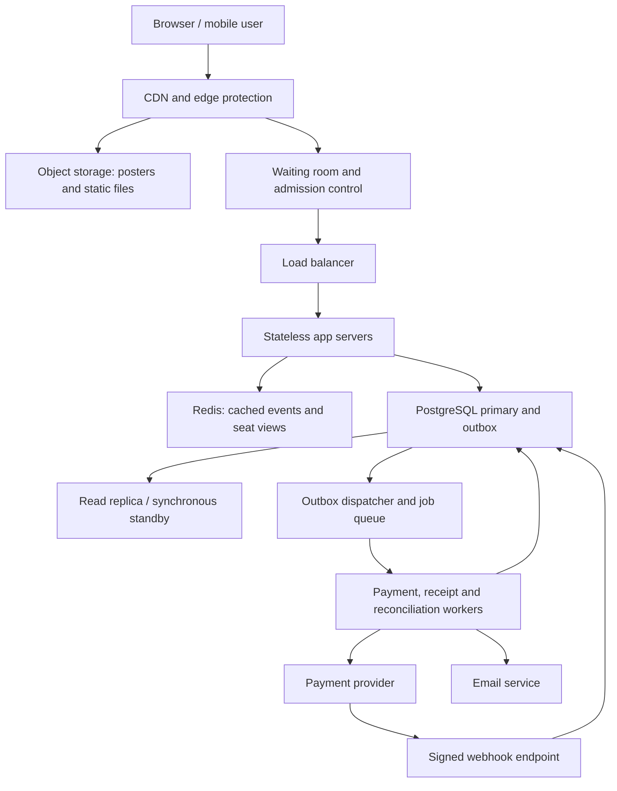

# TicketHub: Event Ticketing System Design

TicketHub helps people discover concerts, choose seats and buy tickets online. This design follows the course's six-part framework. Its main challenge is selling a limited number of seats fairly when many people arrive together.

## 1. Clarify requirements

### Functional requirements

- Browse, search and filter published events by date, location and category.
- View event details, ticket prices and a seat map.
- Sign in, join a popular event's waiting room and temporarily hold selected seats.
- Pay for a valid hold and receive tickets after payment is verified.
- View personal orders and tickets, including a unique ticket code.
- Release abandoned holds so other customers can try again.

### Non-functional requirements

| Quality | Target and design response |
| --- | --- |
| Speed | Target cached browsing responses below 300 ms at the 95th percentile; seat-map and hold API responses below 1 second for admitted users. Queue waiting and external payment time are measured separately. These are targets to validate with load tests. |
| Correctness | A seat must never have two confirmed tickets. The database, transactions and unique constraints decide ownership; a cached seat map cannot guarantee availability. |
| Fairness | Use a server-managed first-in, first-out queue after sales open. Randomise the pre-sale waiting-room group once at opening so arriving hours early gives no advantage. Admit later arrivals behind that group. Issue signed, expiring admission tokens and limit purchases to four seats per account per event. |
| Availability | Target 99.9% monthly availability for browsing and ordinary checkout. If authoritative inventory is unavailable, pause bookings instead of risking duplicate sales. |
| Security | Use HTTPS, hashed passwords, authorisation checks and a payment provider. Store provider references rather than card details; verify payment webhook signatures. |
| Resilience | Retry safe operations, deduplicate payment requests and webhooks, and reconcile uncertain payment outcomes. Confirmed purchases must survive application-server failure. |
| Usability | Support mobile screens, keyboard-accessible seat selection, clear prices and an explicit hold countdown. Explain expired holds, queue position and sold-out events. |

Assumptions: tickets use assigned seats; each event represents one performance; a hold lasts five minutes before payment starts; one active checkout per account per event is allowed. Prices are fixed in this version. Resale, ticket transfers, dynamic pricing and a full organiser administration interface are outside scope. Refunds caused by payment failures are supported operationally, but customer-requested cancellation is outside scope.

## 2. Estimate the scale

Use 86,400 seconds per day and 600 seconds per ten minutes. Page views, API requests and successful ticket sales are different measurements.

### Normal traffic

- Registered users: **2,000,000**.
- Daily visitors: **50,000**.
- Page views: 50,000 × 10 = **500,000 per day**.
- Average page-view rate: 500,000 ÷ 86,400 = **5.79 per second**.
- Tickets sold: **5,000 per day**, or 5,000 ÷ 86,400 = **0.058 tickets per second**.
- Assuming a normal busy period reaches five times average, plan initially for about **29 page views per second** and **0.29 ticket sales per second**. This multiplier is an assumption, not supplied traffic data.

### Popular-concert sale

- Buyers arriving: **200,000 in 600 seconds**.
- Average arrival rate: 200,000 ÷ 600 = **333.33 buyers per second**.
- Seats available: **20,000**. Demand is **10 buyers per seat**, assuming one seat per buyer.
- If all seats sell in ten minutes: 20,000 ÷ 600 = **33.33 successful ticket sales per second**. At most 10% of those buyers receive a seat under the one-seat assumption.
- For a comparable page-view estimate, assume each buyer views ten pages: 2,000,000 ÷ 600 = **3,333.33 page views per second**.
- This is about **576 times normal average page-view traffic**, or **115 times the assumed normal busy-period rate**. The successful ticket-sale rate is also 576 times its normal average.

The 333 buyers per second figure is a ten-minute average, not the instantaneous peak. If 200,000 people arrive in the first ten seconds, the waiting-room edge must absorb about **20,000 arrivals per second**. This is a planning stress scenario, not a fact given in the assignment.

Page views do not include every API call, image request, retry or payment callback. For example, 200,000 clients polling every five seconds would add **40,000 requests per second**. Use edge-served queue updates with jitter and back-off, rather than allowing every waiting user to poll the inventory database.

### Approximate storage

Assume 1 KB per user: 2,000,000 × 1 KB ≈ **2 GB**. Assume an average of 2 KB of combined order, payment and ticket data per ticket sold: 5,000 × 365 × 2 KB ≈ **3.65 GB per year**. At 200 bytes per seat, a 20,000-seat event needs approximately **4 MB** of raw inventory records. These are rough decimal estimates before indexes, replicas, backups and logs. Total event storage cannot be calculated without an event count. Store event posters in object storage, with their URLs in the database.

## 3. Design the API

All endpoints use `/api/v1`. Checkout and personal-ticket endpoints require authentication. The server derives user identity from the session, never from a client-supplied user ID. Lists use cursor pagination.

| Method and endpoint | Purpose and example | Main responses |
| --- | --- | --- |
| `GET /events?city=Nairobi&cursor=...` | Browse events; returns `{"items":[{"id":42,"title":"Nairobi Live"}],"nextCursor":null}`. | `200 OK`, `400 Bad Request` |
| `GET /events/42` | View venue, date, sale time and price information. | `200 OK`, `404 Not Found` |
| `GET /events/42/seats?section=A` | View seat IDs, prices and displayed availability for one section, with an `asOf` timestamp. | `200 OK`, `404 Not Found` |
| `POST /events/42/queue-entries` | Join the waiting room; repeated joins by the same account return the existing entry. | `201 Created`, `200 OK` for an existing entry, `429 Too Many Requests` |
| `GET /queue-entries/q123` | View own queue status and receive an admission token when admitted. | `200 OK`, `403 Forbidden`, `404 Not Found` |
| `POST /holds` | Body `{"eventId":42,"seatIds":[101,102]}` plus admission token during a big sale and an `Idempotency-Key` header. Creates a held order. | `201 Created`, `409 Conflict` if a seat is unavailable, `422 Unprocessable Content` for invalid seat selection, `429 Too Many Requests` |
| `DELETE /holds/o123` | Release an owned hold before payment begins; repeated release is harmless. | `204 No Content`, `409 Conflict` if already paying or paid |
| `POST /orders/o123/payments` | Start payment for the held order using an `Idempotency-Key`. The server calculates the total and returns a provider checkout URL. | `202 Accepted`, `409 Conflict` if expired or ineligible |
| `GET /orders/o123` | View own order, payment state and total. | `200 OK`, `404 Not Found` |
| `GET /me/tickets?cursor=...` | View confirmed tickets belonging to the signed-in user. | `200 OK`, `401 Unauthorized` |
| `POST /webhooks/payments` | Provider-only signed notification; deduplicate by provider event ID and verify amount, currency and order reference. | `200 OK` after durable handling, `400 Bad Request` for invalid payload/signature, `503 Service Unavailable` for a retryable storage failure |

Example hold response:

```json
{
  "orderId": "o123",
  "status": "held",
  "seatIds": [101, 102],
  "totalMinor": 600000,
  "currency": "KES",
  "expiresAt": "2026-11-01T10:05:00Z"
}
```

Amounts use integer minor units: 600000 means KES 6,000.00. An unavailable seat returns a clear error such as `{"error":"SEAT_UNAVAILABLE","seatIds":[101]}`. A successful repeat with the same idempotency key returns the original result; a different payload using that key returns `409`. Other users' private orders return `404` to avoid exposing their existence. Temporary overload returns `429` with `Retry-After`; inventory outages return `503`.

## 4. Design the data model and prevent double-booking

Use PostgreSQL because the data has clear relationships and booking requires atomic transactions. An atomic transaction either commits every change or rolls them all back.

### Tables

| Table | Main columns and constraints |
| --- | --- |
| `users` | `id UUID PRIMARY KEY`, `name TEXT NOT NULL`, `email TEXT UNIQUE NOT NULL`, `password_hash TEXT NOT NULL`, `created_at TIMESTAMPTZ NOT NULL` |
| `events` | `id BIGINT PRIMARY KEY`, `title TEXT NOT NULL`, `venue TEXT NOT NULL`, `starts_at TIMESTAMPTZ NOT NULL`, `sale_starts_at TIMESTAMPTZ NOT NULL`, `poster_url TEXT` |
| `orders` | `id UUID PRIMARY KEY`, `user_id UUID REFERENCES users(id)`, `event_id BIGINT REFERENCES events(id)`, `status TEXT NOT NULL`, `expires_at TIMESTAMPTZ`, `total_minor BIGINT CHECK (total_minor >= 0)`, `currency CHAR(3) NOT NULL`, `request_key TEXT NOT NULL`, `request_hash TEXT NOT NULL`, `created_at TIMESTAMPTZ NOT NULL`, `UNIQUE(user_id, request_key)` |
| `seats` | `id BIGINT PRIMARY KEY`, `event_id BIGINT REFERENCES events(id)`, `section TEXT NOT NULL`, `row_label TEXT NOT NULL`, `seat_number INTEGER NOT NULL`, `price_minor BIGINT CHECK (price_minor >= 0)`, `state TEXT NOT NULL`, `allocation_order_id UUID REFERENCES orders(id)`, `UNIQUE(event_id, section, row_label, seat_number)` |
| `payments` | `id UUID PRIMARY KEY`, `order_id UUID UNIQUE REFERENCES orders(id)`, `provider_reference TEXT UNIQUE`, `idempotency_key TEXT UNIQUE NOT NULL`, `amount_minor BIGINT NOT NULL`, `currency CHAR(3) NOT NULL`, `status TEXT NOT NULL` |
| `tickets` | `id UUID PRIMARY KEY`, `order_id UUID REFERENCES orders(id)`, `seat_id BIGINT UNIQUE REFERENCES seats(id)`, `ticket_code UUID UNIQUE NOT NULL`, `issued_at TIMESTAMPTZ NOT NULL` |
| `payment_events` | `provider_event_id TEXT PRIMARY KEY`, `payment_id UUID REFERENCES payments(id)`, `received_at TIMESTAMPTZ NOT NULL`; deduplicates successfully processed callbacks. |
| `outbox` | `id UUID PRIMARY KEY`, `order_id UUID REFERENCES orders(id)`, `kind TEXT NOT NULL`, `payload JSONB NOT NULL`, `published_at TIMESTAMPTZ`, `UNIQUE(order_id, kind)`; records work to publish after a transaction commits. |

All foreign keys above are also `NOT NULL`, except `seats.allocation_order_id`. Restrict deletion of financial records. Use `CHECK` constraints for the allowed order states (`held`, `payment_pending`, `paid`, `expired`, `cancelled`) and seat states (`available`, `held`, `sold`). A seat check requires a NULL allocation for `available`, and a non-NULL allocation for `held` or `sold`.

Use a composite foreign key from `(seats.allocation_order_id, seats.event_id)` to `(orders.id, orders.event_id)`, backed by `UNIQUE(orders.id, orders.event_id)`, so a seat cannot be allocated to an order for a different event. Validate selected seats before creating the hold. Create a partial unique index on `orders(user_id, event_id)` where status is `held` or `payment_pending`, enforcing one active checkout per account per event.

### Relationships and indexes

- A user has many orders; each order belongs to one user.
- An event has many seats and orders; each seat represents a place at one specific performance.
- An order allocates one to four seats; each seat has at most one current allocating order. Released seats clear this link.
- An order has at most one payment intent and many tickets. A ticket belongs to exactly one order and one seat.
- A payment receives many distinct provider events. An order can have several outbox jobs.

Index `events(starts_at)`, `seats(event_id, section, state)`, `orders(user_id, created_at)`, and pending expiry times. Primary keys and unique constraints already create supporting unique indexes. The `tickets.seat_id UNIQUE` constraint is a final barrier against issuing two tickets for the same event seat.

### Holding a seat safely

A seat-map read followed by an unprotected write is unsafe: two buyers could both see “available”. Instead:

1. Authenticate the buyer, validate sale time, admission token and the maximum of four seats.
2. Start a database transaction. Lock the buyer's `users` row so concurrent requests cannot bypass the account limit; count already purchased seats plus the new selection for this event.
3. Resolve an existing idempotency key, or insert the held order with a five-minute expiry measured using database time. Lock all requested seat rows in ascending ID order with `SELECT ... FOR UPDATE`.
4. Check that all requested seats exist, belong to the event and are `available`. If any is unavailable, roll back the whole request and return `409`; do not create a partial hold.
5. Update all selected seats to `held` with this order ID, save server-calculated prices and commit. The response is sent only after commit.

For example, if Alice and Brian both request seat 101, Alice's transaction locks its row. Brian waits briefly, or receives a retryable conflict after a short lock timeout. Once Alice commits, Brian sees `held` and cannot overwrite it. If Alice rolls back, Brian may acquire it. This works even when requests reach different app servers.

### Payment, expiry and failure races

- To start payment, lock the user row, order row and its seat rows in that order. Confirm ownership, `held` status and an unexpired database timestamp. Change the order to `payment_pending`, create its payment intent and an outbox job in the same transaction. Commit before contacting the provider; never keep database locks open across network requests.
- A worker creates the provider checkout using the stored payment idempotency key. Retrying after a timeout retrieves the same intent rather than charging again. The API may return a processing state until the checkout URL is ready.
- A valid success webhook locks the same records, verifies provider state, amount, currency and seat allocation, inserts tickets, marks seats `sold` and the order `paid`, and inserts a receipt outbox job in one transaction. Record the processed provider event in that transaction too. Duplicate callbacks return success without issuing tickets again. Never confirm a purchase from a browser redirect alone.
- An expiry worker locks the order and seat rows and releases only expired orders still in `held` state. An expiry/payment-start race is resolved by that order lock: either payment starts first or expiry wins. Pending payment seats are not released by the ordinary five-minute expiry worker.
- Pending payments have a provider checkout deadline. If a callback is lost or the deadline passes, a reconciliation worker queries and, when necessary, cancels the provider intent. Keep seats reserved while the outcome is uncertain. Release them only after a verified terminal failure or cancellation that cannot later succeed. A verified success completes the order. Do not guess that a timeout means failure.
- If an unexpected late charge arrives after release, do not take a seat from its new owner. Record the anomaly, issue an idempotent refund and alert support. Legal state transitions prevent a late failure callback from changing a paid order.

Both the expiry worker and payment handlers lock the order before its seats; seat rows are always locked in ascending ID order. Handlers that need the user lock take it first. This consistent order reduces deadlocks; short lock timeouts and bounded retries handle remaining contention.

Redis expiry is only a convenience for displays. Database ownership and order state remain authoritative. Cached availability and read replicas must never approve a hold or confirm payment.

## 5. Draw the high-level architecture

Start with one application and one relational database. Normal traffic is modest. The big sale adds concentrated reads, competing seat writes and payment delays, which justify the following components.



### Component explanations

| Component | Why it is needed |
| --- | --- |
| CDN and edge protection | Serve HTML, JavaScript, posters and waiting-room updates close to users. Apply request limits and bot checks before traffic reaches checkout. Personalised responses must not enter a shared public cache. |
| Object storage | Holds large image/static files without filling database storage or using booking database bandwidth. |
| Waiting room | Keeps most of the 200,000 buyers away from the booking database. Maintain queue state in a highly available server-side store. Validate signed admission tokens at the app; direct API access must not bypass admission. |
| Load balancer | Routes traffic to healthy app instances and removes unhealthy ones. |
| Stateless app servers | Run authentication, browsing and booking logic. Keep session/admission state in shared stores so any instance can handle the next request. Scale instances before the advertised sale. |
| Redis | Cache popular event descriptions and section seat views with short lifetimes; invalidate after inventory changes. It improves speed but does not decide seat ownership. Use separate capacity for queue state so cache pressure cannot evict queue entries. |
| PostgreSQL primary | Owns orders, payments and inventory; performs all booking transactions. Bound database connections and transaction duration. |
| Replica / standby | A read replica can serve event metadata; a synchronous standby in another availability zone supports failover without losing acknowledged booking commits under the configured failure model. Fence the old primary before accepting writes on a replacement. Do not use lagging replicas for seat ownership. |
| Outbox dispatcher and queue | Publish committed jobs reliably. If dispatch fails, the outbox remains available to retry. The queue absorbs bursts of receipts and payment work; consumers deduplicate jobs. |
| Background workers | Expire abandoned holds, create payment sessions, reconcile uncertain payments and send receipts without blocking browsing. |
| Payment provider and webhook | Process money externally; authenticated server-to-server confirmation triggers ticket issuance. |
| Email service | Deliver receipts after confirmation. Email failure does not undo a purchase; tickets remain available in the user's account. |

### Surviving the big sale

1. Pre-cache event details and posters, warm application capacity and test the database before sales open.
2. Put the waiting room at the edge. Start with a conservative admission rate, such as 100 newly admitted shoppers per second, then tune it using measured checkout latency, active shoppers, database connections and payment throughput. This is a starting hypothesis, not a proven capacity limit.
3. Limit active shoppers as well as admissions. Use one queue entry and one active admission per account, an admission window and the four-seat purchase limit. Rate-limit seat refreshes and failed hold attempts. Admission allows a chance to shop; it does not promise a ticket.
4. Cache section seat views; avoid sending or querying all 20,000 seats on every refresh. The final transactional hold resolves stale displays.
5. Monitor database lock waits, connection use, hold success rate, queue wait time, payment-pending age, provider errors, outbox backlog, cache hit rate and the 95th-percentile latency. Reduce admission when checkout slows.
6. Stop new admissions when all seats are sold. If every seat is merely held, pause admissions and explain that more seats may return after expiry.
7. If Redis caching fails, degrade browsing and reduce admissions rather than sending the entire burst to PostgreSQL. If the queue store fails, pause admissions while preserving order. If the database loses its authoritative writer, pause sales until safe failover completes.

The likely first write bottleneck is contention for popular seat rows and database connections, rather than the normal-day average. More app servers alone cannot remove that contention. Admission control and short transactions protect the primary. Load-test simultaneous requests for the same seat, duplicate callbacks, expired holds and provider timeouts, and confirm that each seat produces at most one ticket.

## 6. Discuss bottlenecks and trade-offs

| Choice | Benefit | Cost / alternative considered |
| --- | --- | --- |
| Strong database consistency for booking | Prevents double-booking across app instances. | Conflicting requests wait or fail, and checkout pauses during uncertain failover. An eventually consistent inventory store would improve availability but cannot safely make the same booking guarantee without additional coordination. |
| Waiting room and controlled admission | Protects checkout and gives users a defined queue policy. | Users wait even when app servers have spare capacity. Unrestricted retries feel immediate but favour aggressive clients and can overwhelm the database. |
| Five-minute seat holds | Gives customers time to pay while preserving their chosen seats. | Abandoned holds temporarily remove stock. Shorter holds improve turnover but disadvantage slower users; longer holds encourage hoarding. Payment-pending holds may last longer while their outcomes are verified. |
| Cached seat maps | Fast browsing with fewer database reads. | A displayed seat may already be held; only the hold response confirms availability. Reading the primary for every refresh would improve freshness but increase sale-time load. |
| Single-region primary with standby | Keeps transactions and recovery manageable at this scale. | Distant users have higher write latency and a regional outage can pause sales. Multi-region writers introduce difficult inventory coordination, so they are deferred. |

### Risks and open questions

Account limits reduce bulk buying but do not fully stop people creating multiple accounts; identity checks must balance fairness, privacy and access. Provider cancellation guarantees and payment deadlines must be confirmed before implementing the release policy. The supplied traffic figures do not reveal instantaneous arrival patterns, real API calls per page, or typical seats per order; production measurements and load tests must refine capacity. Backups and restore drills are still necessary because a replica does not protect against accidental data deletion.
