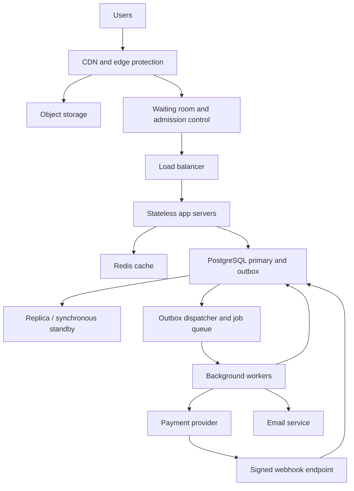

# TicketHub: Event Ticketing System Design

TicketHub lets customers discover events, reserve assigned seats and pay online. The main challenge is selling limited inventory fairly during a sudden rush.

**Review map:** 1. Requirements; 2. Scale estimates; 3. API; 4. SQL data model and double-booking transactions; 5. Architecture; 6. Bottlenecks and trade-offs. All six sections are contained in this file.

## 1. Clarify requirements

### Functional requirements

- Browse, search and filter published events by date, location and category.
- View event details, ticket prices and a seat map.
- Sign in, join a popular event's waiting room and temporarily hold selected seats.
- Pay for a valid hold and receive tickets after payment is verified.
- View personal orders and tickets, including a unique ticket code.
- Release abandoned holds so other customers can try again.

### Non-functional requirements

| Quality | Target and design response |
| --- | --- |
| Speed | Target cached browsing responses below 300 ms at the 95th percentile; seat-map and hold API responses below 1 second for admitted users. Queue waiting and external payment time are measured separately. These are targets to validate with load tests. |
| Correctness | A seat must never have two confirmed tickets. The database, transactions and unique constraints decide ownership; a cached seat map cannot guarantee availability. |
| Fairness | Use a server-managed first-in, first-out queue after sales open. Randomise the pre-sale waiting-room group once at opening so arriving hours early gives no advantage. Admit later arrivals behind that group. Issue signed, expiring admission tokens and limit purchases to four seats per account per event. |
| Availability | Target 99.9% monthly availability for browsing and ordinary checkout. If authoritative inventory is unavailable, pause bookings instead of risking duplicate sales. |
| Security | Use HTTPS, hashed passwords, authorisation checks and a payment provider. Store provider references rather than card details; verify payment webhook signatures. |
| Resilience | Retry safe operations, deduplicate payment requests and webhooks, and reconcile uncertain payment outcomes. Confirmed purchases must survive application-server failure. |
| Usability | Support mobile screens, keyboard-accessible seat selection, clear prices and an explicit hold countdown. Explain expired holds, queue position and sold-out events. |

Assumptions: tickets use assigned seats; each event represents one performance; a hold lasts five minutes before payment starts; one active checkout per account per event is allowed. Prices are fixed in this version. Resale, ticket transfers, dynamic pricing and a full organiser administration interface are outside scope. Refunds caused by payment failures are supported operationally, but customer-requested cancellation is outside scope.

## 2. Estimate the scale

Use 86,400 seconds per day and 600 seconds per ten minutes. Page views, API requests and successful ticket sales are different measurements.

### Normal traffic

- Registered users: **2,000,000**.
- Daily visitors: **50,000**.
- Page views: 50,000 × 10 = **500,000 per day**.
- Average page-view rate: 500,000 ÷ 86,400 = **5.79 per second**.
- Tickets sold: **5,000 per day**, or 5,000 ÷ 86,400 = **0.058 tickets per second**.
- Assuming a normal busy period reaches five times average, plan initially for about **29 page views per second** and **0.29 ticket sales per second**. This multiplier is an assumption, not supplied traffic data.

### Popular-concert sale

- Buyers arriving: **200,000 in 600 seconds**.
- Average arrival rate: 200,000 ÷ 600 = **333.33 buyers per second**.
- Seats available: **20,000**. Demand is **10 buyers per seat**, assuming one seat per buyer.
- If all seats sell in ten minutes: 20,000 ÷ 600 = **33.33 successful ticket sales per second**. At most 10% of those buyers receive a seat under the one-seat assumption.
- For a comparable page-view estimate, assume each buyer views ten pages: 2,000,000 ÷ 600 = **3,333.33 page views per second**.
- This is about **576 times normal average page-view traffic**, or **115 times the assumed normal busy-period rate**. The successful ticket-sale rate is also 576 times its normal average.

The 333 buyers per second figure is a ten-minute average, not the instantaneous peak. If 200,000 people arrive in the first ten seconds, the waiting-room edge must absorb about **20,000 arrivals per second**. This is a planning stress scenario, not a fact given in the assignment.

Page views do not include every API call, image request, retry or payment callback. For example, 200,000 clients polling every five seconds would add **40,000 requests per second**. Use edge-served queue updates with jitter and back-off, rather than allowing every waiting user to poll the inventory database.

### Approximate storage

Assume 1 KB per user: 2,000,000 × 1 KB ≈ **2 GB**. Assume an average of 2 KB of combined order, payment and ticket data per ticket sold: 5,000 × 365 × 2 KB ≈ **3.65 GB per year**. At 200 bytes per seat, a 20,000-seat event needs approximately **4 MB** of raw inventory records. These are rough decimal estimates before indexes, replicas, backups and logs. Total event storage cannot be calculated without an event count. Store event posters in object storage, with their URLs in the database.

## 3. Design the API

Base path: `/api/v1`. Authentication is required for checkout and personal records. Identity comes from the session, not a client-supplied user ID. Lists use cursor pagination.

| Method and path | Purpose | Responses |
| --- | --- | --- |
| `GET /events?city=Nairobi` | Browse/search events. | `200`, `400` |
| `GET /events/42` | Event details, date and prices. | `200`, `404` |
| `GET /events/42/seats?section=A` | Section seat map with an `asOf` timestamp. | `200`, `404` |
| `POST /events/42/queue-entries` | Join waiting room; reuse an existing account entry. | `201`, `200`, `429` |
| `GET /queue-entries/q123` | Own queue status/admission token. | `200`, `403`, `404` |
| `POST /holds` | Atomically hold selected seats. | `201`, `409`, `422`, `429` |
| `DELETE /holds/o123` | Release an owned hold before payment. | `204`, `409` |
| `POST /orders/o123/payments` | Start payment; return processing state or provider checkout URL. | `202`, `409` |
| `GET /orders/o123` | Own order/payment status. | `200`, `404` |
| `GET /me/tickets` | Own confirmed tickets. | `200`, `401` |
| `POST /webhooks/payments` | Signed provider confirmation. | `200`, `400`, `503` |

Example hold request:

```http
POST /api/v1/holds
Authorization: Bearer <session-token>
Idempotency-Key: hold-request-123
X-Admission-Token: <signed-event-token>
Content-Type: application/json

{"eventId":42,"seatIds":[101,102]}
```

Example `201 Created` response, with `Location: /api/v1/orders/o123`:

```json
{"orderId":"o123","status":"held","seatIds":[101,102],"totalMinor":600000,"currency":"KES","expiresAt":"2026-11-01T10:05:00Z"}
```

`600000` minor units means KES 6,000.00. The server calculates prices. A lost response can be retried: the same user/key/payload returns the original result; a changed payload with that key returns `409`. Store the request hash with the order. Payment requests also require an idempotency key.

Unavailable seats return `409` with `{"error":"SEAT_UNAVAILABLE","seatIds":[101]}`. Invalid selections return `422`; unauthenticated protected requests return `401`; private records belonging to others return `404`. Overload returns `429` with `Retry-After`. An unavailable inventory writer returns `503`. Webhooks return success only after durable processing; verify their signatures, order reference, amount and currency.

## 4. Design the data model and prevent double-booking

### PostgreSQL schema

Each seat belongs to one event performance, rather than being a reusable venue seat. Orders contain one to four seats. UUID values are generated by the application; money uses integer minor units.

```sql
CREATE TABLE users (
  id UUID PRIMARY KEY,
  name TEXT NOT NULL,
  email TEXT NOT NULL UNIQUE,
  password_hash TEXT NOT NULL
);

CREATE TABLE events (
  id BIGINT PRIMARY KEY,
  title TEXT NOT NULL,
  venue TEXT NOT NULL,
  starts_at TIMESTAMPTZ NOT NULL,
  sale_starts_at TIMESTAMPTZ NOT NULL,
  poster_url TEXT,
  CHECK (sale_starts_at <= starts_at)
);

CREATE TABLE orders (
  id UUID PRIMARY KEY,
  user_id UUID NOT NULL REFERENCES users(id),
  event_id BIGINT NOT NULL REFERENCES events(id),
  status TEXT NOT NULL CHECK (status IN
    ('held','payment_pending','paid','expired','cancelled')),
  expires_at TIMESTAMPTZ NOT NULL,
  total_minor BIGINT NOT NULL CHECK (total_minor >= 0),
  currency CHAR(3) NOT NULL,
  request_key TEXT NOT NULL,
  request_hash TEXT NOT NULL,
  created_at TIMESTAMPTZ NOT NULL DEFAULT CURRENT_TIMESTAMP,
  UNIQUE (user_id, request_key),
  UNIQUE (id, event_id)
);

CREATE UNIQUE INDEX one_active_checkout
  ON orders(user_id, event_id)
  WHERE status IN ('held','payment_pending');

CREATE TABLE seats (
  id BIGINT PRIMARY KEY,
  event_id BIGINT NOT NULL REFERENCES events(id),
  section TEXT NOT NULL,
  row_label TEXT NOT NULL,
  seat_number INTEGER NOT NULL CHECK (seat_number > 0),
  price_minor BIGINT NOT NULL CHECK (price_minor >= 0),
  state TEXT NOT NULL CHECK (state IN ('available','held','sold')),
  allocation_order_id UUID,
  UNIQUE (event_id, section, row_label, seat_number),
  UNIQUE (id, allocation_order_id),
  FOREIGN KEY (allocation_order_id, event_id)
    REFERENCES orders(id, event_id),
  CHECK ((state = 'available' AND allocation_order_id IS NULL)
      OR (state IN ('held','sold') AND allocation_order_id IS NOT NULL))
);

CREATE TABLE payments (
  id UUID PRIMARY KEY,
  order_id UUID NOT NULL UNIQUE REFERENCES orders(id),
  provider_reference TEXT UNIQUE,
  idempotency_key TEXT NOT NULL UNIQUE,
  amount_minor BIGINT NOT NULL CHECK (amount_minor >= 0),
  currency CHAR(3) NOT NULL,
  status TEXT NOT NULL CHECK (status IN
    ('pending','succeeded','failed','cancelled','refunded'))
);

CREATE TABLE tickets (
  id UUID PRIMARY KEY,
  order_id UUID NOT NULL REFERENCES orders(id),
  seat_id BIGINT NOT NULL UNIQUE,
  ticket_code UUID NOT NULL UNIQUE,
  issued_at TIMESTAMPTZ NOT NULL DEFAULT CURRENT_TIMESTAMP,
  FOREIGN KEY (seat_id, order_id)
    REFERENCES seats(id, allocation_order_id)
);

CREATE TABLE payment_events (
  provider_event_id TEXT PRIMARY KEY,
  payment_id UUID NOT NULL REFERENCES payments(id),
  received_at TIMESTAMPTZ NOT NULL DEFAULT CURRENT_TIMESTAMP
);

CREATE TABLE outbox (
  id UUID PRIMARY KEY,
  order_id UUID NOT NULL REFERENCES orders(id),
  kind TEXT NOT NULL,
  payload JSONB NOT NULL,
  published_at TIMESTAMPTZ,
  UNIQUE (order_id, kind)
);

CREATE INDEX event_dates ON events(starts_at);
CREATE INDEX section_inventory ON seats(event_id, section, state);
CREATE INDEX customer_orders ON orders(user_id, created_at);
CREATE INDEX expiring_holds ON orders(expires_at) WHERE status = 'held';
```

### Relationships and constraint responsibilities

- One user has many orders; one event has many orders and seats.
- An order allocates up to four seats and has at most one payment intent. A released seat clears its allocating order; the expired order remains for audit.
- One order has many tickets; each seat has at most one ticket because `tickets.seat_id` is unique.
- Composite foreign keys ensure a seat is allocated within the correct event and a ticket references the seat's actual allocating order.
- A payment has many distinct provider events. An order has outbox jobs for payment setup and its receipt.

Primary/foreign keys and checks enforce identity, relationships and valid values. Transactional application logic enforces purchase limits and legal state transitions; constraints alone do not implement the complete checkout workflow. Keep financial records rather than cascading their deletion. Use soft deletion where necessary. NoSQL was considered, but relational constraints and transactions fit inventory ownership more directly.

### Atomic hold transaction

A transaction commits all changes together or rolls them all back. PostgreSQL row locks coordinate different app servers:

1. Authenticate, validate event sale time and admission token, and reject duplicate or more than four requested seat IDs.
2. Begin a transaction and lock the buyer's user row. This serialises their competing purchase requests. Resolve the idempotency key and enforce a maximum of four purchased/actively reserved seats per account for this event.
3. Create an order with a five-minute deadline using database time. Lock requested seats in ascending ID order:

```sql
SELECT id, event_id, state, price_minor
FROM seats
WHERE id = ANY($1::bigint[])
ORDER BY id
FOR UPDATE;
```

4. Check that the row count matches the selection, all seats belong to the event, and every state is `available`. On any conflict, roll back everything and return `409`.
5. Update all selected seats to `held` with this order ID, calculate the total from database prices, and commit before responding.

**Race example:** Alice and Brian request seat 101 simultaneously. Alice obtains its row lock. Brian waits briefly. When Alice commits, Brian sees `held` and fails the availability check. If Alice rolls back, Brian can proceed. A stale seat map never grants ownership. Use short lock timeouts and bounded retries; never overwrite a hold after a timeout.

### Payment versus hold expiry

- Payment start locks the user, then order, then seats in ascending ID order. Check ownership, state and expiry using the current database clock after acquiring the order lock. Change `held` to `payment_pending`; create the payment record and payment-setup outbox job atomically.
- Commit before calling the payment provider. A worker uses the stored provider idempotency key, so retrying a timeout creates no second charge. Never hold database locks during a network call.
- The expiry worker locks the order, then its seats. It releases only an overdue order still in `held`. Therefore either expiry wins first or payment start wins first; both cannot succeed. Explicit cancellation follows the same locking rule.
- A verified success callback locks the order and seats, checks the allocation and payment amount/currency, inserts tickets, marks seats `sold` and the order `paid`, and records the processed provider event plus a receipt outbox job in one transaction. Duplicate events do nothing; different success events cannot issue tickets twice because of state checks and `UNIQUE(seat_id)`.
- Never release `payment_pending` seats merely because five minutes passed. Reconcile with the provider after its checkout deadline. Release only after a verified terminal failure/cancellation that cannot later succeed; retain seats while the outcome is uncertain. A browser redirect is not proof of payment.
- If an exceptional late charge arrives after safe release, preserve the new seat owner's booking, record the anomaly, refund idempotently and alert support. A late failure callback must never undo a paid order.

All handlers lock an order before its seats; handlers needing the user lock take it first. Only the primary database approves holds and payments. Redis timeouts and replica reads are never inventory authority.

## 5. Draw the high-level architecture

Start with one app and one database. The measured sale-time burst justifies adding components with specific responsibilities:



- **CDN/edge:** serves cached static content and waiting-room updates near users; rate-limits abusive traffic. Do not publicly cache private orders or tickets.
- **Object storage:** holds event posters and static assets outside the transaction database.
- **Waiting room:** uses a highly available server-side queue store and signed admission tokens. App servers enforce admission even for direct API calls. Keep queue capacity separate from evictable browsing cache.
- **Load balancer:** directs requests to healthy instances.
- **Stateless app servers:** share session state and can scale horizontally; no booking is stored only in one server's memory.
- **Redis cache:** accelerates event descriptions and section seat views. Use short lifetimes and invalidate changed inventory; stale displays are resolved by transactional holds.
- **Primary database:** owns inventory and transactions; bound connections and keep transactions short.
- **Replica/standby:** serves suitable noncritical reads and supports failover. A synchronous standby protects acknowledged commits under its configured failure model. Fence the old writer before promotion; pause checkout until a safe writer exists. Replication does not replace backups.
- **Outbox/queue:** reliably dispatches committed payment and receipt jobs. If publishing fails, retry the stored outbox entry. Consumers must be idempotent because delivery can repeat.
- **Workers:** create payment sessions, expire holds, reconcile uncertain payments and send receipts.
- **Provider/webhook:** processes money externally and confirms it through verified server-to-server messages.
- **Email:** sends receipts asynchronously. Email failure does not remove a confirmed ticket from the customer's account.

### Big-sale operating plan

Warm caches and app capacity before opening. Initially trial 100 admitted shoppers per second, with a separate cap on active shoppers; this is a load-test starting point, not proven capacity. Adjust admission using database lock waits, connections, payment throughput and checkout latency. One account gets one active queue entry/admission; a queue place does not guarantee a ticket.

Serve section seat maps instead of refreshing all 20,000 seats. Use jitter/back-off for queue updates to avoid synchronised polling. Pause admissions if all stock is held; stop admissions when sold out. Reduce admission during cache failure rather than flooding the database. Pause safely during queue-store failure or uncertain database failover.

## 6. Discuss bottlenecks and trade-offs

The first checkout bottleneck is likely competing seat locks and database connections. More app servers cannot remove it; short transactions and admission control can. Monitor queue wait, active shoppers, lock waits, p95 latency, hold conflicts, payment-pending age, provider failures, cache hits and outbox backlog.

| Decision | Benefit | Cost / alternative |
| --- | --- | --- |
| Strong SQL consistency | No duplicate seat ownership. | Conflicting requests wait/fail; sales pause during uncertain failover. Eventual consistency cannot independently promise the same invariant. |
| Waiting room | Fairer access and bounded database load. | Users wait even with spare browsing capacity; unrestricted retries favour aggressive clients. |
| Five-minute holds | Time to pay without losing selected seats. | Abandonment hides stock temporarily. Shorter holds improve turnover but disadvantage slower customers. |
| Cached seat views | Fast browsing and fewer reads. | Availability can be stale; checking the primary on every refresh costs more. |
| Single-region writer | Simpler transactions and recovery. | Distant users have greater write latency; a regional outage may pause sales. Multi-region writers add inventory coordination complexity. |

### Validation and remaining risks

Test two simultaneous buyers for one seat: exactly one hold succeeds. Test partially overlapping multi-seat selections: no partial order survives. Race payment start against expiry, replay webhooks, retry lost payment responses, and simulate app crashes/provider timeouts. Verify one ticket per seat and no second charge. Load-test the 20,000-arrivals/second edge scenario separately from admitted checkout capacity; the design does not claim those tests have already run.

Multiple fake accounts can still evade account limits. Provider cancellation guarantees, real API requests per page, typical seats per order and instantaneous arrival patterns need confirmation. Run backup-restore and safe-failover drills before a major sale.

**End of complete TicketHub design: sections 1–6 included.**
