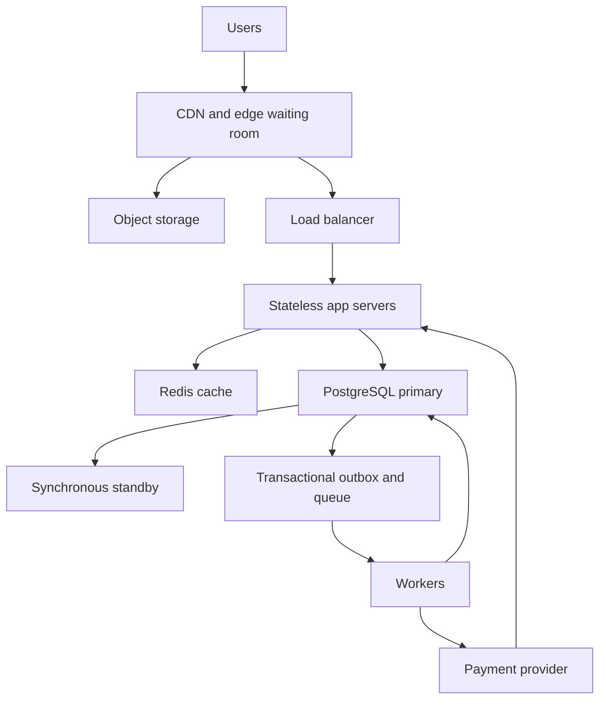

# TicketHub: Complete Event Ticketing Design

TicketHub sells assigned seats; resale is excluded.

## 1. Requirements

Functional: browse events/seats, sign in, queue, hold 1-4 seats, pay, view tickets, expire holds.

Non-functional: target p95 browsing <300 ms, admitted holds <1 s and 99.9% availability. Never double-book. Randomise pre-sale arrivals; later arrivals use FIFO. Signed admission tokens, account purchase limits and rate limits promote fairness. Use HTTPS, password hashes and ownership checks; store no card details. Pause checkout when inventory is uncertain.

## 2. Scale estimates

Given: 2 million users, 50,000 daily visitors, 10 pages/visitor and 5,000 daily sales. Day = 86,400 seconds.

| Measure | Normal daily average | Popular sale: 600 seconds |
| --- | --- | --- |
| Page views | 500,000/day = 5.79/s | Assuming 10/buyer: 2 million = 3,333/s |
| Buyer arrivals | Not specified | 200,000/600 = 333/s |
| Successful tickets | 5,000/86,400 = 0.058/s | If sold out: 20,000/600 = 33.33/s |

Sale pages: 576 times normal average, or 115 times an assumed 5x normal peak. Demand: 10 buyers/seat at one seat/buyer. 10-second surge: 20,000 arrivals/s. Five-second polling: 40,000 requests/s; use caching, jitter/back-off.

## 3. API

Prefix `/api/v1`; private routes require login. Paginate lists.

| Method/path | Purpose | Status |
| --- | --- | --- |
| GET /events | Search/browse | 200 |
| GET /events/{id}/seats | Section availability | 200,404 |
| POST /events/{id}/queue-entries | Join waiting room | 201,429 |
| POST /holds | Reserve selected seats | 201,409,422 |
| DELETE /holds/{orderId} | Release own hold | 204,409 |
| POST /orders/{id}/payments | Start payment | 202,409 |
| GET /me/tickets | Own confirmed tickets | 200,401 |
| POST /webhooks/payments | Signed provider confirmation | 200,400,503 |

Hold: `{"eventId":42,"seatIds":[101,102]}` returns orderId/status/expiresAt; conflict = 409. Hold/payment Idempotency-Key retries return the original result; changed payloads fail. Server calculates prices.

## 4. Data model and double-booking

PostgreSQL (PK: primary key; FK: foreign key):

| Table | Columns and constraints |
| --- | --- |
| users | id PK, email UNIQUE NOT NULL, password_hash NOT NULL |
| events | id PK, title, venue, starts_at, sale_starts_at |
| orders | id PK, user_id FK users, event_id FK events, status, expires_at, total_minor CHECK >=0, currency, request_key; UNIQUE(user_id,request_key) |
| seats | id PK, event_id FK events, section,row,number,price_minor,state,order_id FK orders; UNIQUE(event_id,section,row,number) |
| payments | id PK, order_id UNIQUE FK orders, provider_reference UNIQUE, status, idempotency_key UNIQUE |
| tickets | id PK, order_id FK orders, seat_id UNIQUE FK seats, ticket_code UNIQUE |

User/event to orders and event to seats: one-to-many. Order: 1-4 seats, one payment, many tickets. Composite FKs ensure event/order/seat agreement. State checks and one-active-checkout/account/event unique index apply. Index event dates, seat availability and expiry.

**Hold transaction:** lock buyer, enforce four-seat account limit and deduplicate request. Lock requested seats in ID order with SELECT FOR UPDATE. Verify event and availability. If any fails, roll back all; otherwise create five-minute held order, assign seats, commit. Alice locks seat 101; Brian waits, sees held, receives 409. Locks coordinate all app servers.

**Payment/expiry race:** payment locks user, order, seats; checks expiry using database time after locking. Atomically mark payment_pending and save payment/outbox job. Commit before provider calls; use provider idempotency keys. Expiry locks order then seats; release only expired held orders. Whichever acquires the order lock first wins.

Keep pending seats until reconciliation confirms success or terminal failure/cancellation. Verified success atomically inserts tickets, marks seats sold/order paid and records a unique webhook ID plus receipt job. UNIQUE(tickets.seat_id) prevents second issuance. Duplicate callbacks do nothing; browser redirects cannot confirm payment. Unexpected late charges after release are refunded, preserving the new owner's seat. Never hold database locks during network calls.

## 5. Architecture

CDN serves static content/queue updates; object storage holds posters. Waiting room controls fair admission with signed tokens. Load balancer routes to healthy stateless apps using shared sessions. Redis caches seat views, never ownership. PostgreSQL executes transactions; synchronous standby supports fenced failover. Outbox/queue retries committed jobs; workers expire holds, reconcile payments and send receipts. Provider sends signed callbacks through apps.

Start with one app/database; bursts justify added components. Prewarm; trial 100 admissions/s with an active-shopper cap, load-test and tune. Monitor latency, connections, lock waits/backlog. Reduce admission under overload; pause unsafe failover.

## 6. Bottlenecks and trade-offs

Bottlenecks: seat locks and database connections; add admission control, not just apps.
- Consistency prevents duplicates but pauses unsafe checkout.
- Waiting rooms protect capacity/fairness but add delay.
- Caches speed reads but stale seats need hold validation.
- Holds allow payment time but hide abandoned stock.

Test races and duplicate callbacks: one ticket/seat, no double charge. Provider cancellation and fake accounts remain risks. Load/recovery tests are planned.

END OF COMPLETE DESIGN - ALL SIX SECTIONS INCLUDED.
